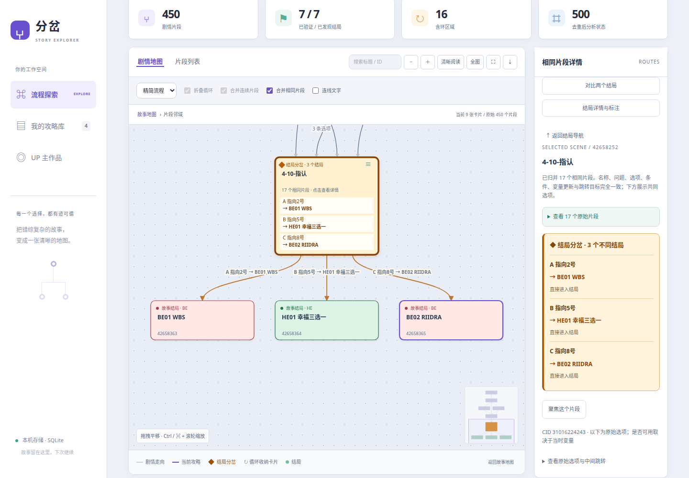
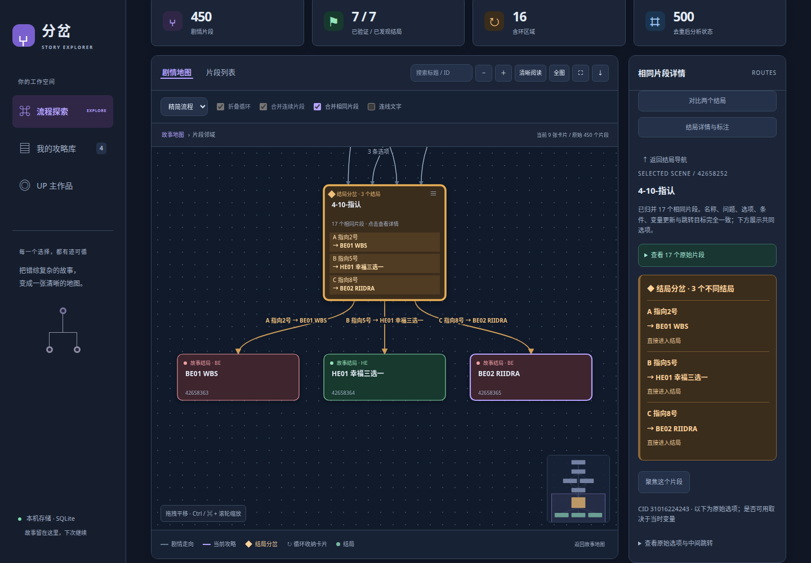

# 分岔 · Bilibili 互动视频剧情探索器

把互动视频的每一次选择变成可阅读的剧情地图，追踪条件与累计评分，寻找通往结局的最少步骤路线。

**[在线体验 → https://story-explorer.nas.haiqingd.top:1443/](https://story-explorer.nas.haiqingd.top:1443/)**

> 体验地址请保留 **1443** 端口。当前服务的公网 443 不可访问。

中文界面，Python 标准库服务，SQLite 持久化，原生 JavaScript / SVG 前端。核心功能不依赖 Node.js 或外部数据库；可选的片尾文字识别使用本地 FFmpeg、Tesseract 和 Pillow，Docker 镜像已包含这些组件。

## 能做什么

- **采集完整分支**：输入视频链接、BV 或 av 号，逐片段读取剧情、选项、条件和变量变化，显示采集进度与完整性状态。
- **读懂大地图**：章节总览、精简流程与完整节点三种视图；循环与连续片段可收纳，支持搜索定位、拖拽、缩放、小地图和全屏。
- **归并重复片段**：名称、问题、选项、后继节点、条件及变量更新完全一致时，显示为一张卡片，并保留所有原始 ID 和入口。
- **突出结局分岔**：用橙色菱形标记直通不同结局的关键节点，显示「哪个选择 → 哪个结局」，有评分条件时明确列出条件。
- **验证结局攻略**：根据当前片段、问题与累计变量搜索路线，保留自动跳转和循环回访；可复制攻略或逐步查看。
- **对比两条路线**：查看同一问题的不同选项、分岔前后变量，并追溯相关评分赋值。
- **整理结局名称**：自动识别标题与片尾卡片中的结局名称及明确的 HE／BE 分类，保留截图证据、待核对状态和人工修正入口。
- **保存与继续探索**：攻略库支持收藏、标签、UP 主筛选、排序、JSON 导入导出及作者作品目录。
- **浅色与暗色模式**：支持跟随系统与手动切换，记住偏好；页面、地图、弹窗及 SVG 导出一起适配。

## 界面预览

浅色地图：重复片段归并后，关键选项与结局对应关系直接显示在卡片上。



暗色地图：保留 HE／BE、循环、章节和关键分岔的语义配色。



截图来自已解析的互动视频；首次自行部署时攻略库为空。点击「体验离线示例」即可体验虚构的「雾港来信」剧情，无需请求 Bilibili。

## 快速开始：Docker

需要 Docker 与 Docker Compose。独立部署使用 `compose.standalone.yaml`，不需要已有的 Nginx 网络。

```bash
git clone https://github.com/haiqingd/bilibili-interactive-video-looper.git
cd bilibili-interactive-video-looper
mkdir -p data

# Linux 上使用当前用户的 UID / GID，保证挂载目录可写。
LOOPER_UID=$(id -u) LOOPER_GID=$(id -g) \
  docker compose -f compose.standalone.yaml up -d --build --wait
```

打开 <http://127.0.0.1:8765>。该配置只绑定本机回环地址；公网 HTTPS 部署见 [部署说明](docs/deployment.md)。Dockerfile 当前使用国内镜像源构建。

端口被占用时：

```bash
LOOPER_PORT=8787 LOOPER_UID=$(id -u) LOOPER_GID=$(id -g) \
  docker compose -f compose.standalone.yaml up -d --build --wait
```

随后打开 <http://127.0.0.1:8787>。

查看状态、日志和停止容器：

```bash
docker compose -f compose.standalone.yaml ps
docker compose -f compose.standalone.yaml logs --tail 50 app
docker compose -f compose.standalone.yaml down
```

`data/` 中的数据库与片尾证据会保留。更新代码后重新执行构建命令即可。

仅运行核心功能也可以使用 Python 3.11+：

```bash
python3 server.py
```

无需安装 Python 第三方依赖。片尾识别依赖及网关部署方法见 [部署说明](docs/deployment.md)。

## 使用流程

1. 输入互动视频链接、BV 或 av 号，点击「解析视频」。暂不支持 b23 短链接。
2. 查看采集进度。读取失败时会保存部分结果，并明确提示尚未完成的部分。
3. 在剧情地图中逐层探索，点击节点查看原始选项、条件和评分变化。
4. 点击结局卡片高亮路线，或勾选「只看当前攻略」查看每次转换的发生位置。
5. 使用「对比两个结局」检查不同选择及变量变化；使用「结局详情与标注」核对识别结果。
6. 在攻略库收藏、分类或导出 JSON，下次继续探索。点击作者名字可以查看已解析作品及按需读取的投稿目录。

普通滚轮滚动页面；Ctrl／⌘ + 滚轮缩放地图。手机支持拖拽与双指缩放。全屏内滚轮直接缩放，按 Esc 或「退出全屏」返回。切换全屏或外观时保留地图的比例与阅读位置。

## 怎么理解分析结果

**最少步骤包含自动跳转，不代表最短观看时长。** 相同剧情片段在不同累计评分下可能提供不同选项，因此分析器按「片段 + 当前问题 + 后续仍会读取的变量」区分状态，而不是只在节点之间找最短路。

- 只有完整状态搜索且相关条件已知时，才能给出全结局与最少步骤结论。
- 遇到随机条件、未知表达式、节点缺失、风控或搜索上限时，会标记为部分分析；已验证路线仍可查看。
- 「含环区域」表示剧情可以回访；只有可达变量状态没有任何出口时，才标记为已确认状态闭环。
- 相同片段与同名结局的归并只影响展示，原始节点、条件、评分和攻略步骤继续保留。
- HE／BE 分类来自明确标题、片尾文字或人工标注，不根据角色死亡或评分高低猜测。
- 两条路线的变量依赖追溯不代表唯一触发原因或最小因果干预证明。

默认上限为 1,500 个采集片段、20,000 个状态、300 次转换。算法、表达式支持范围、地图聚合规则及 OCR 边界见 [分析与展示细节](docs/analysis.md)。

## 登录、风控与数据

部分接口需要登录，可在「登录设置」中填写自己的 Bilibili Cookie。Cookie 只用于当次请求，不进入数据库、JSON 导出、浏览器存储或请求日志。登录不保证解除 HTTP 412／429 等访问限制。

- 攻略库位于 `data/guides.sqlite3`，片尾证据位于 `data/ending-evidence/`。
- 备份完整 `data/` 可保留攻略、收藏、标签、标注及证据。运行时备份数据库请使用 SQLite backup API，或先停止服务再复制。
- JSON 导出包含流程与结局标注；证据图片需要单独备份。导入时会重算分析并丢弃其他机器的证据路径。
- 本仓库不包含运行数据库、Cookie、证书或片尾证据。
- 在线体验中的攻略库由服务端共享；自行部署时数据保存在自己的服务器。

## 开发与测试

服务端与算法测试：

```bash
python3 -m unittest discover -s tests -v
```

若全局 HTTP 代理影响本机测试请求，可在命令前设置 `NO_PROXY='*' no_proxy='*'`，让测试直接访问本机临时服务。

无需浏览器的地图与路线测试（需要 Node.js）：

```bash
node tests/map.cjs
node tests/compare.cjs
node tests/forks.cjs
```

浏览器回归需要系统 Chrome 与 Playwright，可用 `CHROME_PATH`、`PLAYWRIGHT_MODULE` 指定位置，并通过 `LOOPER_URL` 指向已经运行的服务：

```bash
LOOPER_URL=https://story-explorer.nas.haiqingd.top:1443 node tests/forks-browser.cjs
LOOPER_URL=https://story-explorer.nas.haiqingd.top:1443 node tests/theme.cjs
```

这些案例回归依赖部署中已有的攻略。`tests/browser.cjs` 会创建离线示例并修改测试用收藏与标签，运行它时请使用测试数据库。测试覆盖状态搜索、循环、条件、自动跳转、节点归并、结局分岔、暗色模式、手机布局与历史恢复。

## 文件结构

```text
server.py                 HTTP API、静态页面与后台任务
looper/                   Bilibili 采集、状态搜索、存储、结局识别
static/                   原生 JavaScript、CSS 与交互 SVG 地图
compose.standalone.yaml   独立 Docker 部署
compose.yaml              已有 Nginx 网关网络下的部署
Dockerfile                含 FFmpeg / Tesseract / Pillow 的镜像
deploy/                   HTTPS 网关配置模板
docs/analysis.md          分析算法、展示规则与完整性边界
docs/deployment.md        自部署与公网 1443 入口说明
docs/graph-format.md      可导入的流程 JSON 格式
tests/                    算法、HTTP 与浏览器回归
```

本项目通过互动视频接口逐节点采集数据，未使用一个能够直接返回全部剧情和结局的接口。接口研究参考见 [Bilibili 互动视频文档](https://github.com/alittlehuaji/bilibili-api-collect-mirror/blob/master/docs/video/interact_video.md)。
